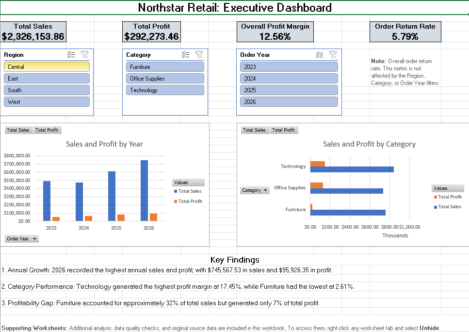
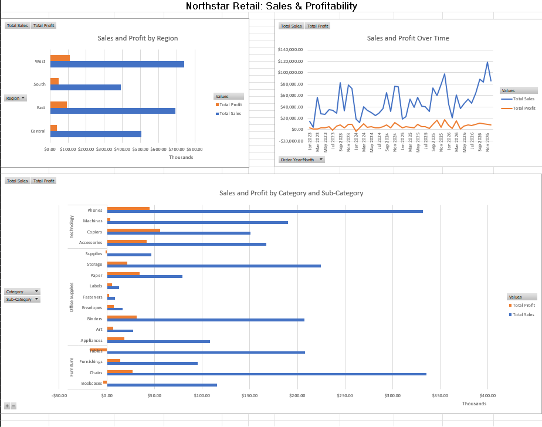
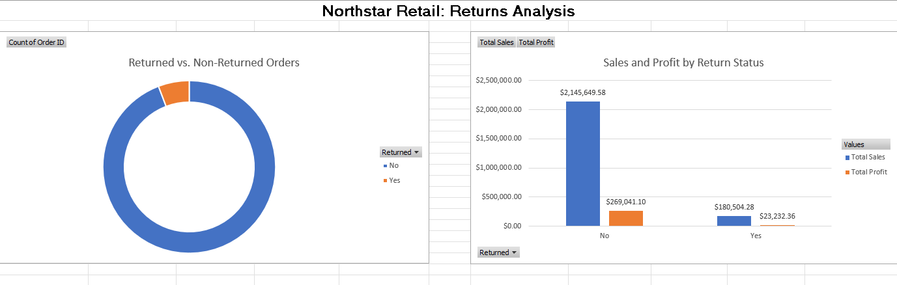

# Northstar Retail | Sales, Profitability & Returns Analysis

## Project Overview

This project analyzes sales, profitability, and product returns for Northstar Retail, a fictional retail business. Using the Sample Superstore dataset, the project demonstrates an end-to-end data analysis workflow in Microsoft Excel, including data assessment, cleaning, quality checks, business analysis, and interactive dashboard development.

The objective is to identify sales trends, evaluate profitability across product categories and geographic regions, and assess the frequency and financial impact of returned orders.

## Dashboard Previews

### Executive Dashboard


### Sales & Profitability


### Returns Analysis


## Repository Structure

```text
Northstar-Retail-Analysis/
│
├── raw_data/
│   └── Sample-Superstore.xlsx
│
├── documentation/
│   └── Initial Questions About Data.docx
│
├── screenshots/
│   ├── Executive-Dashboard.png
│   ├── Sales-and-Profitability.png
│   └── Returns-Analysis.png
│
├── workbook/
│   └── Northstar-Retail-Analysis.xlsx
│
└── README.md
```

### Folder Contents

- **raw_data:** Contains the original, unmodified Sample Superstore dataset.
- **documentation:** Contains the initial data assessment questions and findings recorded before the analysis.
- **screenshots:** Contains screenshots of the three completed dashboard pages.
- **workbook:** Contains the finished Excel workbook, including cleaned data, supporting analysis, PivotTables, and dashboards.

All data preparation, transformations, calculations, and analysis are contained within the Excel workbook. Supporting worksheets are hidden by default but can be accessed using Excel's Unhide option.

## Tools & Technologies

- **Microsoft Excel:** Data analysis, formulas, PivotTables, PivotCharts, and dashboard development.
- **Power Query:** Data transformation, type correction, duplicate investigation, and dataset merging.
- **Excel Tables:** Structured data management and calculated columns.
- **PivotTables & PivotCharts:** Data aggregation and visualization.
- **Excel Slicers:** Interactive filtering by region, product category, and order year.

## Initial Data Assessment

Before beginning the analysis, the source data was reviewed to understand its structure, completeness, and suitability for reporting.

Initial findings included:

| Metric | Result |
|---|---:|
| Original order records | 10,194 |
| Distinct orders | 5,111 |
| Distinct customers | 804 |
| Order date range | January 3, 2023 to December 30, 2026 |
| Missing values | None identified |
| Duplicate Order IDs | Present |

The initial assessment is documented separately in `documentation/Initial Questions About Data.docx`.

## Data Preparation & Quality Assurance

Power Query was used to prepare the transaction data for analysis.

Key preparation steps included:

- Correcting data types for dates, numerical values, and text fields.
- Converting postal codes to text to preserve formatting and leading zeroes.
- Reviewing column quality and checking for missing or invalid values.
- Investigating duplicate transactions using the original transaction fields while excluding Row ID.
- Documenting potential duplicate records and their financial impact in a separate data quality audit.
- Merging return information into the transaction data using Order ID.
- Replacing missing return indicators with "No" to distinguish returned and non-returned orders.

Two duplicate transaction records were removed from the analysis dataset. The original source data was retained, and the potential financial impact of the duplicate records was documented separately.

Additional calculated fields were created to support future analysis:

- Shipping Days
- Profit Margin
- Order Year
- Order Month
- Order Month Name
- Order Quarter
- Order Year-Month

## Analysis & Dashboards

The completed workbook contains three interactive dashboard pages.

### 1. Executive Dashboard

Provides a high-level overview of business performance through four key performance indicators:

- Total Sales
- Total Profit
- Overall Profit Margin
- Order Return Rate

The dashboard also highlights annual and category performance.

Interactive slicers allow users to filter the sales and profitability analysis by:

- Region
- Product Category
- Order Year

### 2. Sales & Profitability

Examines business performance in greater detail through:

- Regional Performance
- Monthly Sales and Profit Trends
- Sub-Category Performance

This analysis helps identify geographic differences, changes in performance over time, and product-level profitability patterns.

### 3. Returns Analysis

Examines the frequency and financial impact of returned orders.

The dashboard includes:

- Returned versus non-returned order counts.
- Overall order return rate.
- Sales and profit comparisons between returned and non-returned orders.

The return rate is calculated using distinct Order IDs rather than individual product rows, ensuring that each order is counted only once.

**Note:** The overall order return rate is calculated independently and is not affected by the Executive Dashboard slicers.

## Key Findings

### Overall Performance

| Metric | Result |
|---|---:|
| Total Sales | $2,326,153.86 |
| Total Profit | $292,273.46 |
| Overall Profit Margin | 12.56% |
| Order Return Rate | 5.79% |

### Annual Performance

- 2026 recorded the highest annual sales at **$745,567.53** and the highest annual profit at **$95,926.35**.
- 2025 recorded the strongest annual profit margin at **13.46%**.
- 2023 had the lowest annual profit margin at **10.46%**.

### Category Performance

- Technology generated the highest profit at **$146,543.38**, with a profit margin of **17.45%**.
- Office Supplies achieved a profit margin of **17.22%**.
- Furniture had the weakest profitability, with a margin of only **2.61%**.
- Furniture represented approximately 32% of total sales but contributed only about 7% of total profit.

### Returns

- 296 of 5,111 distinct orders were marked as returned.
- This represents an overall order return rate of **5.79%**.

## Skills Demonstrated

This project demonstrates practical experience with:

- Data assessment and quality assurance.
- Data cleaning and transformation using Power Query.
- Duplicate investigation and reconciliation.
- Data merging and calculated fields.
- Excel formulas and structured tables.
- PivotTables and PivotCharts.
- KPI development and profitability analysis.
- Time-series and comparative analysis.
- Interactive dashboard development using slicers.
- Translating transactional data into business insights.
- Communicating findings through data visualization.

## Data Source

The project uses the Sample Superstore dataset made available through Tableau's sample data resources.

Northstar Retail is a fictional business created for this portfolio project. The analysis is intended for demonstration and educational purposes.